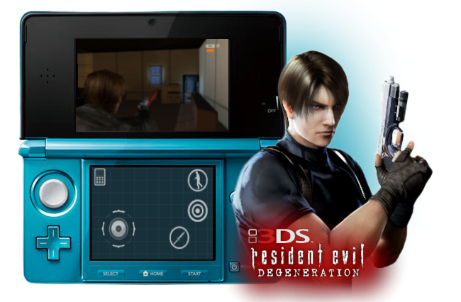

<p align="center">
  
</p>

---

A port of the Android version of Resident Evil: Degeneration to the Nintendo 3DS. It runs the game's
original ARM code; everything under it (the Airplay system layer, OpenGL ES, sound and input) was
rewritten for the 3DS.

> [!IMPORTANT]
> **No game files are included here or in the release.** You must provide your own copy of the Android version.
>
> For compatibility, the port has been tested with the **Sharp Galapagos SoftBank 003SH / 005SH exclusive version**, commonly identified as `Resident Evil Degeneration Android iOS Port Sharp Galapagos Softbank 003SH 005SH Exclusive Fix.apk`.
>
> Other versions may not work correctly. The required game assets must be obtained and extracted from a copy you are legally entitled to use.

## Download & Install

Grab `ResidentEvilDegeneration.cia` from the [Releases](../../releases) page and install it with
FBI. You need a 3DS with Luma3DS.

Then the game files. Open your `.apk` with any zip tool and take these four out of its `assets/`
folder: `biohazard.s3e`, `main.dz`, `s3e.icf` and `app.icf`. Make a folder called `reDe` at the
root of your SD card and copy them in, together with `port.icf` from this repo, like this:

```
SD card
└── reDe/
    ├── biohazard.s3e
    ├── main.dz
    ├── s3e.icf
    ├── app.icf
    └── port.icf
```

Keep the names exactly as they are. You don't need `intro.mp4` or anything else from the apk, and
your files are only read, never modified.

For sound you also need a DSP dump at `sdmc:/3ds/dspfirm.cdc`. If you don't have one, run DSP1
once. Without it the game still runs, just silent.

Then launch it from the HOME menu. Saves go to `sdmc:/reDe/` (`savedata1.i3d`, `savedata2.i3d`)
and the log is at `sdmc:/reDe/log.txt`.

## Controls

<p align="center">
  
</p>

The Android version is played entirely with the touch screen. The port moves all of its on-screen
buttons to the bottom screen, where you can still tap them, and puts the important ones on real
buttons too:

| 3DS | In game |
|---|---|
| Circle Pad / D-Pad | move |
| R (hold) | aim the gun |
| L (hold) | pull out the knife |
| A | shoot or slash with what you're holding, otherwise open doors and use things |
| Y | put the weapon away |
| X / Select / Start | phone (map, items, files) |
| B | bottom right icon |
| Start + Select | quit |

In menus the D-Pad or Circle Pad moves a highlight over the options, **A** picks one, **B** goes
back and **L / R / X** press the icons in the corners.

The game's 3D mode works and can be turned on from its Options menu. It costs a lot of speed,
at least in the O3DS (device where i tested).

## Settings

`port.icf` has a few switches you can change with any text editor:

* **Patch:** the default line sets the game to English and starts it with 3D off. For Spanish
  replace `84cb0:a1540421` with `84cb2:a154`.
* **BottomScreen=0:** keeps the on-screen buttons on the top screen like the phone did.
* **HideTextures:** hides the little signal icon the phone version shows. Remove the line to get it back.
* **Perf=1:** writes the frame rate and timings to `log.txt` once a second. Leave it off when you
  just want to play, writing to the SD card every second causes small hitches.

## AI Assistance

Parts of the code were written or improved with the assistance of AI (Claude, by Anthropic). That
includes reverse engineering of the game's functions, data and touch interface, and the tools in
`tools/`. All AI-assisted code was reviewed, tested, and manually validated, with the overall
implementation and debugging process remaining under human supervision.

## Credits

* **Capcom** for Resident Evil: Degeneration. This project isn't affiliated with Capcom.
* **Ideaworks3D** for the Airplay SDK the game was built on.
* **devkitPro** for devkitARM, libctru and citro3d, and **XZ Utils** for liblzma.
* **3DSGuy** for makerom and **Steveice10 / Epicpkmn11** for bannertool.

## Building from source

You need devkitARM with libctru, citro3d and `3ds-liblzma`, plus `makerom` and `bannertool` in
your `PATH` (or in `tools/bin/`):

```bash
dkp-pacman -S 3ds-dev 3ds-liblzma
make
```

The CIA ends up as `biohazard.cia`. The HOME menu icon and banner are in `meta/`.

`tools/` has the Python scripts used to take the game apart (they need `unicorn`, `capstone`,
`numpy` and `pillow`):

* `unpack_s3e.py` unpacks `biohazard.s3e` into the raw game image, `dz.py` lists and extracts
  `main.dz`.
* `emu.py` runs the whole game on unicorn with a minimal runtime, `GLSOFT=1` renders frames to PNG.
* `xdis.py`, `xref.py`, `calls.py`, `plt.py`, `vtable.py` and `slotrefs.py` are for finding your
  way around the game's code.

